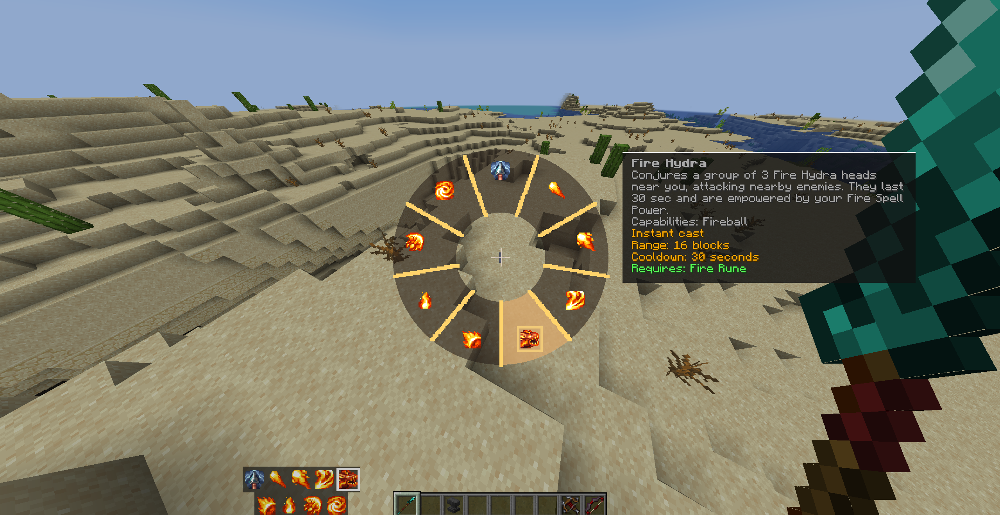

# Better Spell Casting

English | [简体中文](README.zh-CN.md)

[](LICENSE) [](#) [](#) [](#)

**Better Spell Casting** is a client-side overhaul of the [Spell Engine](https://github.com/ZsoltMolnarrr/SpellEngine) casting workflow. It introduces a radial spell selector, a cleaner and customizable spell HUD, flexible casting keybinds, and optional left-click bow and crossbow controls.



## ✨ Features

- **Radial Spell Selector**: Hold the select key to open a radial menu, point at a spell, and release to select it (includes a center dead zone to preserve your current selection). Displays the focused spell's name and full Spell Engine description while open.
- **Flexible Casting & Shortcuts**: Cast your active spell using a dedicated keybind, or optionally enable number-key shortcuts to cast specific spell slots directly without changing your radial selection.
- **Customizable Spell HUD**: Switch between a **Single-Row** or **Dynamic Three-Row** spell bar layout, and scale its size freely from **50% to 150%**.
- **Left-Click Ranged Weapons (Optional)**: Rebind bow and crossbow drawing/firing to the Left Mouse Button. Retains vanilla item-use mechanics while automatically suppressing melee attacks and block breaking during ranged weapon use.
- **Seamless Compatibility**: The HUD, radial menu, and shortcuts share a unified selection route that strictly follows Spell Engine's native candidate ordering and availability rules. Works out-of-the-box with *Wizards*, *Paladins & Priests*, *Archers*, *Rogues & Warriors*, and other Spell Engine content mods.

## 🎮 Controls & Configuration

- **Keybinds** (`Options → Controls → Better Spellcasting`):
  - **Select Spell**: Hold `X` (default) to open the radial selector.
  - **Cast Selected Spell**: `Right Mouse Button` (default).
- **Mod Settings** (`Options → Spellcasting Settings`):
  - Enable/disable direct number-key shortcut casting.
  - Toggle left-click bow and crossbow controls.
  - Configure spell bar layout (single-row / dynamic three-row) and scale (50% – 150%).

## 📦 Installation & Compatibility

- **Environment**: **Client-side only**. Server installation is not required; the mod adds no server protocols or gameplay registries.
- **Required Dependency**: **[Spell Engine](https://github.com/ZsoltMolnarrr/SpellEngine)** (matching your Minecraft version and mod loader).

> ⚠️ **Incompatibility Notice**: Remove the legacy `spell-cycle` JAR from your `mods` folder before installing. Better Spell Casting supersedes its workflow, and loading both mods will cause duplicate key handling, overlapping HUDs, or mixin conflicts.

## 🛠️ Building & Development

Each supported target is maintained on its own branch and compiles strictly against **Spell Engine** (without compile-time dependencies on content mods):

| Minecraft | Loader   | Branch            | Java Version |
| --------- | -------- | ----------------- | ------------ |
| 1.20.1    | Fabric   | `1.20.1-fabric`   | JDK 17       |
| 1.20.1    | Forge    | `1.20.1-forge`    | JDK 17       |
| 1.21.1    | Fabric   | `1.21.1-fabric`   | JDK 21       |
| 1.21.1    | NeoForge | `1.21.1-neoforge` | JDK 21       |
| 26.1      | Fabric   | `26.1-fabric`     | JDK 25       |
| 26.1      | NeoForge | `26.1-neoforge`   | JDK 25       |

Check out the target branch and pass the matching Spell Engine JAR path via `-Pspell_engine_jar` (artifacts output to `build/libs/`):

```bash
# Linux / macOS
./gradlew clean build -Pspell_engine_jar="/path/to/spell_engine.jar"

```

```powershell
# Windows PowerShell
.\gradlew.bat clean build -Pspell_engine_jar="D:\path\to\spell_engine.jar"

```

## 📄 License

Licensed under the [MIT License](https://www.google.com/search?q=LICENSE).
