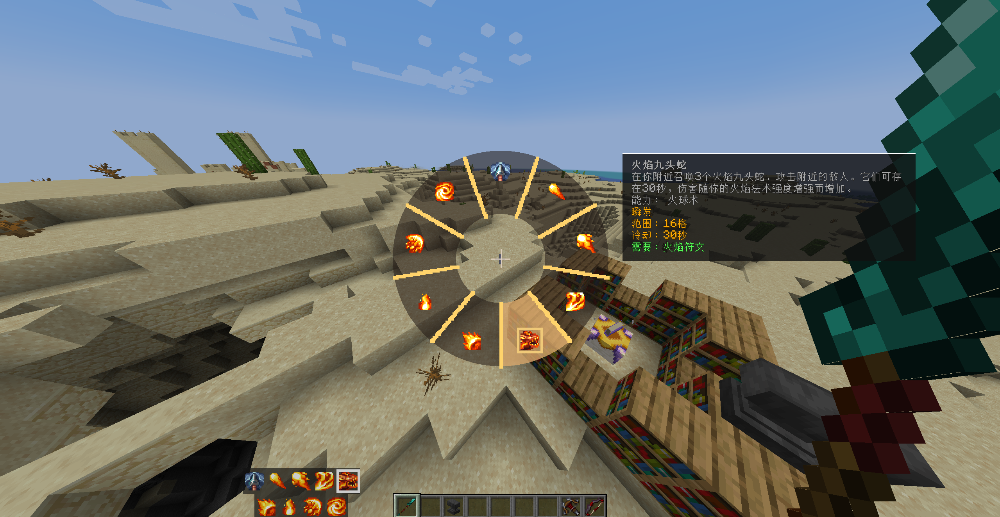

# 更好的施法操作（Better Spell Casting）

[English](README.md) | 简体中文

[](LICENSE) [](#) [](#) [](#)

**Better Spell Casting** 是一个纯客户端模组，用于全面改进 [法术引擎（Spell Engine）](https://github.com/ZsoltMolnarrr/SpellEngine) 的施法操作体验。它提供了施法轮盘、更清晰的法术栏 HUD、可自由配置的施法按键，以及可选的左键弓弩操作。



## ✨ 功能特性

- **施法轮盘**：按住选择键打开轮盘，鼠标指向目标法术并松开即可切换；轮盘中心设有防误触死区以保持当前选择。打开轮盘时会实时显示聚焦法术的名称与 Spell Engine 详细描述。
- **独立施法键与快捷键**：支持使用独立按键（默认右键）释放当前选中法术；也可开启数字快捷键直接施放对应槽位的法术，且不会打乱轮盘当前的选中状态。
- **自定义法术栏 HUD**：法术栏支持**单排**与**动态三排**布局切换，并支持 **50% – 150%** 的无级缩放。
- **左键弓弩操作（可选）**：支持将弓和弩的拉弓/蓄力改到鼠标左键。完整保留原版物品使用逻辑，同时在持远程武器射击期间自动屏蔽左键攻击与挖掘方块。
- **原生规则无缝兼容**：法术栏、轮盘与快捷键共用同一套底层逻辑，严格遵循 Spell Engine 原生的法术候选顺序与可用性判定（手持物品、法术书、可用状态等），无需额外配置即可完美兼容 *Wizards*、*Paladins & Priests*、*Archers*、*Rogues & Warriors* 等所有附属内容模组。

## 🎮 按键与配置

- **按键绑定**（`选项 → 按键控制 → 更好的施法操作`）：
  - **切换选中法术**：默认按住 `X` 打开轮盘
  - **释放选中法术**：默认 `鼠标右键`
- **模组设置**（`选项 → 法术切换设置`）：
  - 启用/禁用数字快捷键直接施法
  - 切换弓弩左键操作模式
  - 调整法术栏布局（单排 / 动态三排）与缩放比例（50% – 150%）

## 📦 安装与兼容性

- **端侧要求**：**仅客户端（Client-side Only）**。服务端无需安装，不添加任何网络协议或服务端数据。
- **前置依赖**：必须安装对应版本的 **[Spell Engine](https://github.com/ZsoltMolnarrr/SpellEngine)** 及其所需前置。

> ⚠️ **冲突警告**：如果你之前安装过旧的 `spell-cycle` 模组，请务必将其从 `mods` 文件夹中**移除**。本模组已完整包含其工作流，同时加载会导致按键处理重复、HUD 重叠或 Mixin 冲突。

## 🛠️ 构建与开发

每个支持的目标平台均在独立分支上维护，编译时仅依赖目标版本的 **Spell Engine**（不依赖任何具体法术内容模组）：

| Minecraft | 加载器 | 对应分支 | 所需 Java 版本 |
| --- | --- | --- | --- |
| 1.20.1 | Fabric | `1.20.1-fabric` | JDK 17 |
| 1.20.1 | Forge | `1.20.1-forge` | JDK 17 |
| 1.21.1 | Fabric | `1.21.1-fabric` | JDK 21 |
| 1.21.1 | NeoForge | `1.21.1-neoforge` | JDK 21 |
| 26.1 | Fabric | `26.1-fabric` | JDK 25 |
| 26.1 | NeoForge | `26.1-neoforge` | JDK 25 |

检出对应分支后，通过 `-Pspell_engine_jar` 传入本地匹配的 Spell Engine 构件路径即可构建（构建产物位于 `build/libs/`）：

```bash
# Linux / macOS
./gradlew clean build -Pspell_engine_jar="/path/to/spell_engine.jar"

```

```powershell
# Windows PowerShell
.\gradlew.bat clean build -Pspell_engine_jar="D:\path\to\spell_engine.jar"

```

## 📄 许可证

本项目基于 [MIT](https://www.google.com/search?q=LICENSE) 许可证开源。
